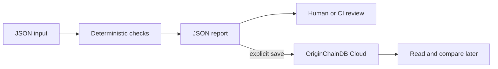

# Catch wrong answers beside valid citations

**rag-evidence-lab** is a Python starter for startup teams building AI products.

Evaluate answer fixtures against expected facts, citation IDs, exact evidence quotes, and unanswerable questions.

## When to use it

A founder changes retrieval settings and needs a repeatable release check. The checked-in fixture is synthetic and deliberately includes failure cases so you can inspect what gets caught.

[](https://github.com/originchaindb/rag-evidence-lab/actions/workflows/ci.yml)

## Run locally

Requires Python 3.11+ (standard library only).

```sh
git clone https://github.com/originchaindb/rag-evidence-lab.git
cd rag-evidence-lab
python -m unittest discover -s tests -v
python app.py run examples/input.json
```

This evaluates a file and prints JSON. It makes no model or database request. Read [the example result](examples/expected.json) and [input contract](docs/INPUT.md) before substituting your own data.

## Use OriginChainDB Cloud Free

Create or use a Free instance in the [Cloud console](https://app.originchaindb.com). Copy its HTTPS application endpoint and **tenant from the Connect example**. The tenant is not the instance ID.

Copy `.env.example` to `.env` and enter the existing instance key as `OC_BEARER`. Keep this file private. Environment variables take precedence. Set a fresh `OC_NAMESPACE` for this project; namespaces must start with a lowercase letter and contain only lowercase letters, digits, or underscores (48 characters maximum).

```sh
python app.py cloud-smoke examples/input.json
python app.py save examples/input.json
python app.py list
python app.py get RUN_ID_FROM_SAVE
```

`save` calculates the report, registers or verifies `rag_evidence_lab.runs_v1`, and writes one run. `get` reads a saved result; `list` returns the latest 20 run IDs. `cloud-smoke` also verifies a second-client read and SQL lookup. Use a separate namespace for synthetic checks. It retains small test records; no existing data is deleted.

Every run contains a unique ID, creation time, input SHA-256, and JSON report. The original input is not automatically saved, but reports can contain excerpts or identifiers; review your data before uploading. No local database fallback is used by `save` or `cloud-smoke`.

## AI integration

The core accepts recorded application/model outputs where relevant and works with Claude, OpenAI, or other providers. No Ollama installation is required. No paid model call occurs automatically. See [Claude capture](docs/CLAUDE.md) for an optional one-request capture helper.

## How the pieces fit



## Boundaries

Deterministic evidence checks do not prove semantic entailment. Maintain human-reviewed cases and review paraphrases manually.

This is a small CLI/reference implementation, not a hosted service. It has no public HTTP listener or user authentication. [Production guidance](docs/PRODUCTION.md) explains the controls needed before embedding it in a service. [Verification](docs/VERIFICATION.md) distinguishes tests from live checks.

## References

- [OriginChainDB HTTP API](https://originchaindb.com/docs/api) — schemas, rows, SQL and authentication.
- [OriginChainDB SQL](https://originchaindb.com/docs/sql) — query semantics.
- [Anthropic: evaluating AI agents](https://www.anthropic.com/research/demystifying-evals-for-ai-agents) — motivation for outcome-based checks.
- [Anthropic: context engineering](https://www.anthropic.com/research/effective-context-engineering-for-ai-agents) — context selection tradeoffs.

MIT licensed. Contributions should include a reproducible input, expected behavior, and a regression test. Never put credentials or customer data in issues.
